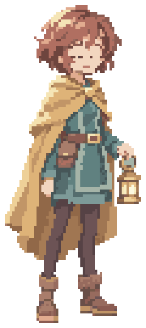

# PixelAgent

[中文介绍](README.zh-CN.md) · [User guide](docs/USER_GUIDE.md) · [Download the Windows preview](https://github.com/crackthedream/pixelagent/releases/tag/v0.1.0-alpha.1)

Turn a character description or a reference picture into a transparent pixel sprite, give it facial expressions, and export a sprite atlas for a game. PixelAgent is a Windows desktop app. You work on a local project, review the plan and drawing, and can ask for a revision before exporting.

| Standing | Happy | Blink |
| :---: | :---: | :---: |
|  |  |  |

The **Lantern Courier** is an actual output from the release verification run. The three frames share a canvas and pivot so the character stays in place when a game switches expressions. [Download the example game pack](https://github.com/crackthedream/pixelagent/releases/download/v0.1.0-alpha.1/Lantern_Courier_game_pack.zip).

## Run your first character

1. Open the [v0.1.0-alpha.1 release](https://github.com/crackthedream/pixelagent/releases/tag/v0.1.0-alpha.1). Under **Assets**, download **PixelAgent-Windows-x64.zip**.
2. Extract the ZIP and open **PixelAgent.exe**. The bundle includes Python and the drawing engine. A local browser window displays the app.
3. The first launch starts in **Test run**. Create a project and enter a character description. Follow the approval prompts and save a **Game pack** to try the workflow for free. The art in this mode is a placeholder.
4. For original artwork, open **Settings**, enter your own OpenAI API key, select **OpenAI**, review the spending limits, and save. This mode sends the text and relevant images for each model task to OpenAI.

## Two ways to draw

| Look | How the sprite is made | When to use it |
| --- | --- | --- |
| **Soft** | An image model draws pixel art. PixelAgent recovers its grid, adjusts the palette and prepares the sprite and layers. | Character bases and matching facial expressions. |
| **Classic** | GPT-6.2 Sol inspects the reference and issues drawing commands through the PixelLiner MCP engine. | A model-drawn sprite with an inspectable sequence of drawing steps. |

You can select a region for a local revision, keep earlier drawing versions and export the character as a PNG. A game pack includes a PNG atlas, frame metadata compatible with Aseprite-style JSON, and a Godot SpriteFrames resource. This preview focuses on characters and expressions.

## Models, cost and verification

Planning and Classic drawing use **GPT-6.2 Sol**. Pairwise comparisons can use **GPT-6.2 Astra**. Soft drawing and expression edits use **GPT Image**. Smaller model roles handle tasks such as labeling and visual checks. Real runs use the user's API account. Project spending limits take effect against recorded estimates, so the final request can take the total past a threshold.

The application passed **245 offline regression tests**. The public ZIP was checked on the release machine using a fresh user profile, Test run and Edge. The preceding build of the same application code completed the live Lantern Courier verification, including both drawing methods, a smile, a blink and pairwise judging. Its **40 API calls totaled an estimated US$0.57905**. A single character's cost depends on its settings, retries and revisions.

[Windows verification and cost breakdown](docs/WINDOWS_VERIFICATION_2026-11-18.md) · [English guide](docs/USER_GUIDE.md) · [中文使用指南](docs/USER_GUIDE.zh-CN.md)

## Feedback

See the [contribution guide](CONTRIBUTING.md) for bug reports and feature proposals, the [security policy](SECURITY.md) for sensitive reports, and the [changelog](CHANGELOG.md) for release history.

PixelAgent's application source is [MIT licensed](LICENSE). The bundled drawing engine and third-party components have [separate distribution terms](DISTRIBUTION.md).
